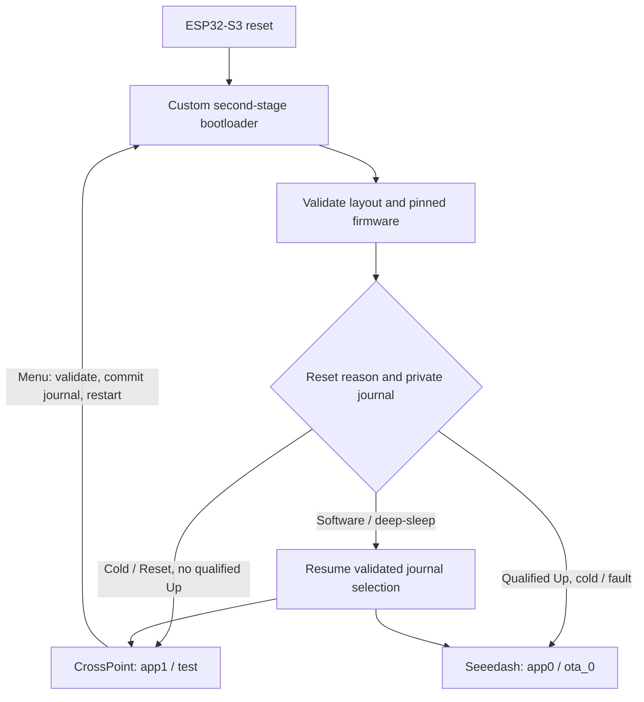

# reTerminal Sticky Dual Boot

**CrossPoint EPUB reader + factory Seeedash 1.2.0 on Seeed reTerminal Sticky (ESP32-S3, 32 MiB Flash).**

CrossPoint starts by default. Its **Settings → System → Switch to Seeedash** menu starts the original Seeedash application. A physical Reset without Up returns to CrossPoint.

Version **v1.0.0** packages the Stage 4 integration. The project owner reports that the Stage 4 update, both applications, USB switching, menu switching on battery and physical Reset return work on their device. This is a report from one device, not validation of every hardware revision. A build from this repository is a new artifact until tested on hardware; see [validation](docs/VALIDATION.md).

> **All standard OTA updates are unsupported and forbidden.** Do not use CrossPoint OTA, Seeedash firmware/resource updates, or child-device updates. They can overwrite the other application or its data. Keep Seeedash offline and unpaired for this release.

## Release contents and licensing

This is a **source release**. It includes the custom bootloader, a pinned CrossPoint patch, the partition layout, build/verification scripts, notices and documentation. It contains **no factory Seeedash binary, complete Flash image, device dump, credentials or user data**.

Seeedash binary redistribution permission has not been established. CrossPoint's MIT license also does not cover every library in its compiled firmware; GPL/LGPL corresponding-source and relinking obligations have not been closed for a public binary package. Compiled firmware assets are therefore withheld in v1.0.0. The local build creates a matched update pair and, optionally, a complete 32 MiB fresh-install image. See [licensing and provenance](docs/LICENSING.md).

## Hardware and controls

- Seeed **reTerminal Sticky**, ESP32-S3, **32 MiB Flash**. Other reTerminal models and Flash sizes are unsupported.
- Working battery, stable USB-C power, a data cable and reliable ESP32 ROM download access.
- No Secure Boot, Flash encryption, anti-rollback or download restrictions. This integration does not configure eFuses.
- An independent verified backup before installation or an update.

| Action | Result |
| --- | --- |
| Normal cold start / physical Reset without Up | CrossPoint |
| CrossPoint menu → Switch to Seeedash | Validated private journal request, software restart, Seeedash; reported working on battery |
| Up + physical Reset | Emergency Seeedash selection; reported working with USB |
| Deep-sleep wake | Resume selected system by journal; physical Up selection ignored |

For emergency selection, hold Up through Reset for at least 600 ms, then release it within the next 2 seconds and leave it released for 30 ms. A permanently held button is rejected. Battery Up+Reset is **not confirmed**. This gesture does not enter the ESP32 ROM download mode.

## Device photos

Real photographs have not been supplied for redistribution. Maintainers should add their own licensed photos to `docs/images/` showing:

- CrossPoint reading an EPUB on Sticky;
- the Switch to Seeedash menu;
- Seeedash running on the same device.

No simulated device photographs are included.

## How it works

The factory application and storage extents stay at their original addresses. CrossPoint has its own NVS. `app1` is a **test** application, not a second native OTA slot. The loader uses a separate two-sector `bootstate` journal. [Architecture and full partition map](docs/ARCHITECTURE.md).

## Install

1. Read [recovery](docs/RECOVERY.md) and establish ROM download access.
2. Follow the [pinned local build](docs/BUILD.md).
3. Choose **[Fresh Install](docs/INSTALL.md)** for a destructive local 32 MiB image, or **[Update / Preserve Data](docs/UPDATE.md)** for an already compatible Dual Boot device.
4. Verify SHA-256, the actual device layout and both code segments before writing anything.

Never flash the generic PlatformIO bootloader, `boot_app0.bin`, a default partition table, or only one member of an update pair. In particular, **0xe000 is inside factory NVS**. Build scripts have no serial/flashing action, and the dedicated PlatformIO profile rejects upload/debug/filesystem targets. Manual esptool instructions are deliberately separate.

## Limits and safe updates

An update of two code segments is **not power-fail atomic**. Bootloader interruption may require ROM recovery. SHA-256 checks detect accidental corruption and mismatched pairs; they are not authenticated Secure Boot. The unmodified Seeedash firmware is not sandboxed and can still write arbitrary Flash through its own updater. Native OTA restrictions alone cannot prevent that.

The NVS wrappers isolate CrossPoint from factory NVS. Corrupt CrossPoint NVS may still trigger library recovery that erases **cp_nvs**, including keys for protected books. Keep backups. Book file formats and storage locations are unchanged.

See [troubleshooting](docs/TROUBLESHOOTING.md), [validation limits](docs/VALIDATION.md), [changelog](CHANGELOG.md), and [release notes](RELEASE_NOTES.md).

## Credits

Based on [CrossPoint Reader](https://github.com/crosspoint-reader/crosspoint-reader) and [FreeInk SDK](https://github.com/Free-Ink/freeink-sdk), with a custom [ESP-IDF](https://github.com/espressif/esp-idf) bootloader. [Reader+ by Angel Esteban](https://github.com/estebangel-crypto/reader-plus) informed the validate → persist → restart sequence; no Reader+ source is incorporated. Factory firmware originates from [Seeed Studio's official registry](https://github.com/Seeed-Projects/reterminal-sticky-playground-registry). This is an independent community integration, not an official Seeed Studio release.

Original integration code, scripts and documentation use the scoped [MIT license](LICENSE). The IDF-derived bootloader entry uses Apache-2.0; existing CrossPoint material retains MIT. See [NOTICE](NOTICE) and [third-party licenses](licenses/).
